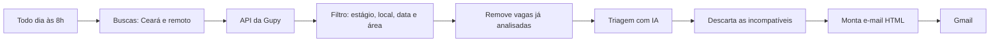

# Monitor de vagas de estágio · n8n + IA

Automação que procura vagas de estágio todos os dias, usa um modelo de linguagem para avaliar se cada vaga é compatível com o meu perfil e me envia por e-mail só as que valem a candidatura.

## Problema

Encontrar estágio exigia abrir o portal da Gupy, filtrar por cidade e modalidade e ler a descrição de cada vaga para descobrir se o meu curso, o meu período de formatura e a minha cidade eram aceitos. A maior parte das vagas não servia, e eu só descobria isso depois de ler tudo.

## Como funciona

1. **Busca:** consulta a API pública do portal da Gupy duas vezes, uma para estágios no Ceará e outra para estágios remotos.
2. **Filtro em código:** mantém só vagas do tipo estágio, publicadas nos últimos 7 dias e cuja descrição menciona áreas compatíveis (engenharia, exatas, tecnologia, dados ou "qualquer curso"). Isso reduz as chamadas ao modelo.
3. **Deduplicação:** o nó *Remove Duplicates* guarda os IDs já processados, para a mesma vaga não ser analisada duas vezes.
4. **Triagem com IA:** um LLM recebe o meu perfil e a descrição da vaga e responde em JSON com veredito (`candidatar`, `candidatar com ressalvas` ou `não candidatar`), motivo, requisitos que atendo, pontos de atenção e lacunas. O prompt é uma versão do [prompt 05 de triagem de vagas](https://github.com/BielCarioca03/prompts-engenharia/blob/main/prompts/05-triagem-vagas.md).
5. **E-mail:** as vagas compatíveis viram um e-mail HTML com um cartão por vaga e o link para se candidatar.

## Decisões de projeto

- **Filtro determinístico antes da IA:** regras simples (tipo de vaga, local, data, área) ficam em JavaScript, e o modelo só recebe o que exige interpretação de texto. Fica mais barato e mais previsível.
- **Saída estruturada:** o modelo responde em JSON, e um nó de código faz o parse e trata respostas inválidas, sem quebrar o fluxo.
- **Regras explícitas no prompt:** no primeiro teste, o modelo descartou uma vaga que aceitava "Engenharia ou áreas afins". Para corrigir, acrescentei regras explícitas sobre cursos e local e troquei o modelo (gpt-4o-mini → gpt-4.1).

## Tecnologias

n8n (Schedule Trigger, HTTP Request, Code, Remove Duplicates, Basic LLM Chain, OpenAI Chat Model, Gmail) · JavaScript · API do portal Gupy · OpenAI gpt-4.1

## Como usar

1. Baixe o arquivo [`monitor-vagas.json`](monitor-vagas.json).
2. No n8n, crie um workflow vazio e cole o conteúdo do arquivo no canvas (Ctrl+V).
3. Conecte uma credencial da OpenAI no nó **Modelo de IA** e uma do Gmail no nó **Enviar e-mail**.
4. Troque `SEU_EMAIL_AQUI` pelo seu e-mail e edite o perfil no nó **Triagem com IA**.
5. Publique o workflow.
